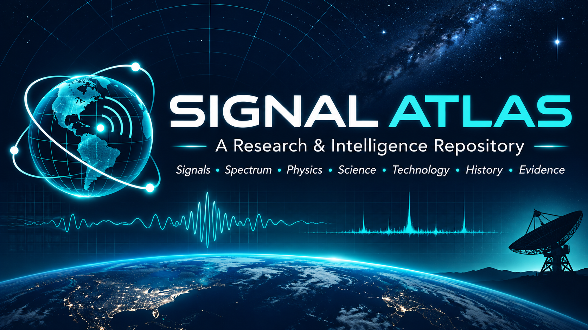
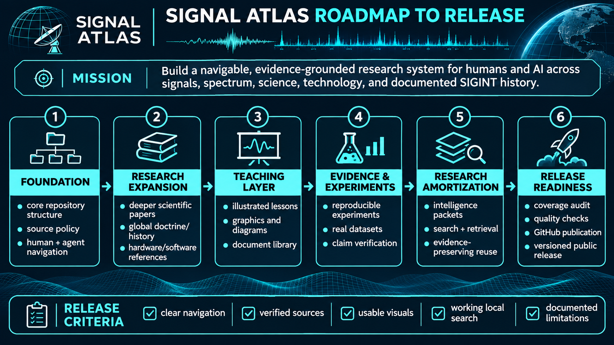
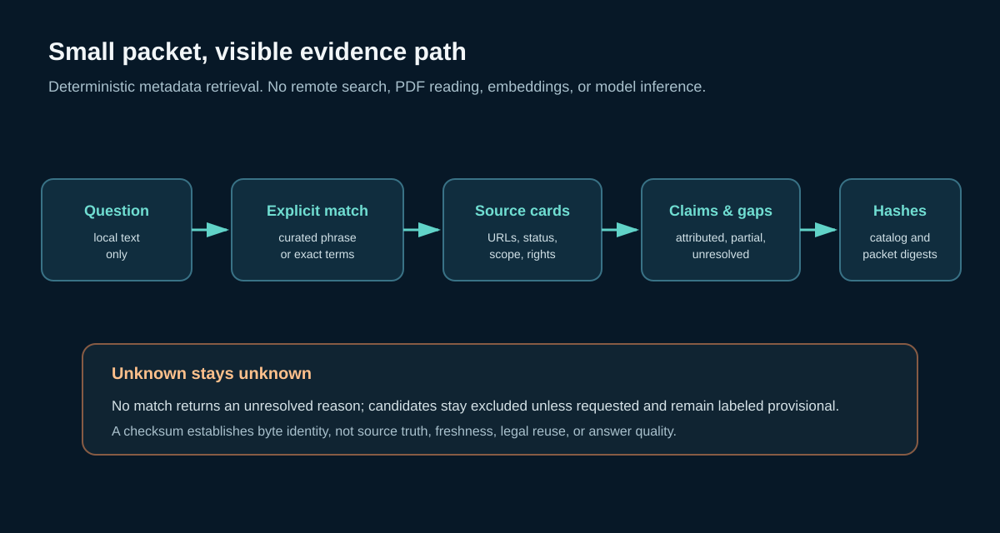
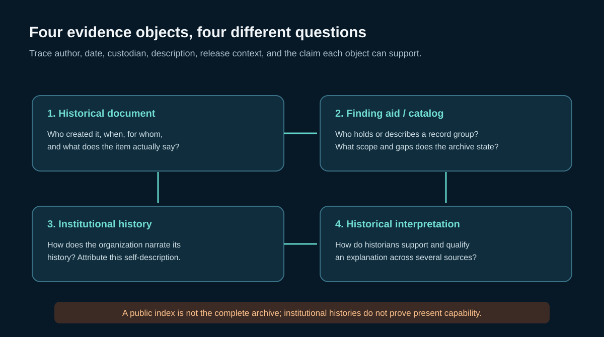

# SIGNAL ATLAS

## Current edition: v1.0

This first complete edition unifies public sources, scoped claims, lessons, research documents, and registered datasets. It adds a frozen GOES X-ray snapshot, exact channel pairing, public military SIGINT history, offline search, and a collection coverage view. Start with the [unified search](site/unified_search.html), [dataset coverage](site/coverage.html), [solar-wind explorer](site/solar_wind.html), [dataset registry](data/dataset_registry.json), [collection guide](docs/research/DATA_COLLECTION_GUIDE_v10.md), or [roadmap to v1.0](docs/research/ROADMAP_TO_1.0.md). The evergreen logo above remains version independent.

### Evidence-grounded signal research · Electromagnetic science · Public SIGINT history · Human and AI learning

**Edition:** v1.0 · **Source cards:** 150 · **Scoped claims:** 82 · **Research notes:** 21 · **World profiles:** 18 · **Lessons:** 30 · **Scientific reference records:** 26 · **Dataset registrations:** 10 · **Original SVG diagrams:** 31 · **Research pass:** 2026-11-03

> **Mission:** Build a versioned, navigable research atlas for electromagnetic signals, measurement science, lawful technology, public military SIGINT history, and evidence-aware AI retrieval.

**Core research rule:** Discover → Verify → Connect → Teach → Reuse → Measure. Curated records link to original sources; public access is not a reuse license. The Atlas is an offline metadata library, not a full web crawl or an interception tool.

**Roadmap to v1.0:**

**What v1.0 adds:** a dated GOES soft X-ray snapshot and exact channel pairs; five public history routes; offline search, data coverage, provenance, two lessons, a navigational graphic, and an AI-readable packet.

**What v0.6 adds:** a measurement-science chapter and reproducible synthetic Allan-deviation lab; expanded public historical record routes for the U.S., UK, Canada, and Australia; seven new attributed science/history claims; three reference records; two sequenced lessons; three accessible SVG teaching diagrams; an inspectable alias-aware packet format with source, claim, and alias hashes; and v0.6 release checks. Earlier v0.5 datasets and evaluation receipts remain intact as historical evidence.

[**Start here**](START-HERE.md) · [**Unified search**](site/unified_search.html) · [**Dataset coverage**](site/coverage.html) · [**Browse source records**](site/index.html) · [**Topic map**](site/topic-map.html) · [**Roadmap to release**](assets/signal_atlas_roadmap_to_release.png) · [**v1.0 release audit**](docs/research/RELEASE_AUDIT_v10.md) · [**Resume handoff**](THREAD-RESUME-HANDOFF.md)

## Explore the library

| Destination | What it contains |
| --- | --- |
| [Offline source explorer](site/index.html) | Curated source cards, claims, lessons, profiles, and topic navigation |
| [Unified offline search](site/unified_search.html) | Search source cards, claims, datasets, publications, lessons, notes, and research documents |
| [Dataset coverage](site/coverage.html) | Inspect data kinds, capture windows, files, and known collection gaps |
| [30-lesson course](courses/README.md) | Signal foundations, public history, measurement, and research practice |
| [Science guide](docs/science/README.md) | Wave physics, sampling, remote sensing, and measurement science |
| [Public history guide](docs/research/PUBLIC_HISTORICAL_RECORDS_v10.md) | NSA, GCHQ, and ASD routes with source roles and limits |
| [Scientific reference index](documents/INDEX.md) | Publication and technical-reference records; four original Atlas PDFs |
| [Technology guide](docs/technology/README.md) | SDR, receivers, metadata standards, reproducibility, and lawful workflows |
| [Research desk](docs/research/README.md) | Evidence workflow, open questions, and collection notes |
| [Research packet schema](docs/research/PACKET_SCHEMA_v06.md) | Provenance, deterministic packet fields, and evidence limits |
| [Agent instructions](AGENTS.md) | Read-only workflow, attribution rules, evidence statuses, and safety boundaries |

## A small, auditable packet

Run `python tools/packet_query_v06.py "clock stability" --limit 5`. The result includes source URLs and scope, attributed claims, matched alias phrases, explicit input-file hashes, and a packet checksum. Candidates are excluded by default. Unmatched requests remain unresolved. This is deterministic local metadata retrieval: it does not access websites, read full-text PDFs, execute an LLM, or measure model-compute savings.

The curated aliases are inspectable in [query_aliases_v06.json](data/query_aliases_v06.json). Seven aliases repair exact misses from the earlier 20-query curated diagnostic; the resulting compatibility score reuses those known targets and is not a blind or held-out evaluation. See [packet method and limits](docs/research/PACKET_SCHEMA_v06.md) and the [v0.6 audit](docs/research/RELEASE_AUDIT_v06.md).

## Measurement science and public history

The measurement unit distinguishes frequency stability from accuracy and calibration uncertainty, introduces a stated Allan variance estimator, and provides a fixed-seed synthetic lab. See [the chapter](docs/science/07_frequency_stability_and_uncertainty.md), [lesson 25](courses/25-frequency-stability-and-measurement.md), and [lab instructions](experiments/frequency_stability_lab_README.md).

The historical guide separates an archival finding aid from a released document, an institution's history, and an independent interpretation. It covers public U.S. National Archives and NSA pathways, the UK's HW archival route, and institutional accounts from Canada and Australia. Each claim remains attributed; incomplete public records do not establish absence, and history does not establish present capability.

## Evidence model and boundaries

1. Navigate from topic to source card to scoped claim to original URL.
2. Separate a source's statement, independent assessment, inference, and unknown.
3. Keep spectrum allocations, observed transmissions, regulatory monitoring, and SIGINT claims distinct.
4. Treat dates as part of every claim. A historical source does not support a current assertion without a new source.
5. Do not catalogue active tactical emitters, intercepted private communications, target locations, secret methods, or exploitation instructions.
6. Copy third-party material only when its rights allow it. This release links to external records and papers; their files are not mirrored.

The library contains 150 source records, not a mirror of the Internet. Search and coverage describe the frozen package, not the world-wide completeness of sources or measurements.

## Release history

- **v0.5:** added 22 unique public sources, a 30-day NOAA solar-radio-flux excerpt and analysis, six scientific resources, 24 lessons, 25 SVGs, an offline topic map, and an author-curated retrieval diagnostic. Its data, code, and diagnostic receipt are preserved unchanged in this package.
- **v0.6:** adds eight source cards, seven claims, three scientific records, two lessons, three accessible diagrams, the frequency-stability lab, a public records workflow, and provenance-bound local research packets.
- **Optional evaluation:** retrieval or human/model answer-quality studies can be added if they help users. This release measures index integrity and search behavior, not scientific conclusions or model improvement.

See [source policy](SOURCE_POLICY.md), [research method](RESEARCH_METHOD.md), [release summary](docs/research/RELEASE_SUMMARY_v06.md), and [thread-resume handoff](THREAD-RESUME-HANDOFF.md).

**Content rights:** original Atlas writing and diagrams are supplied as a draft research package without asserting a third-party license. Linked material remains subject to its original owner's rights. See [license decisions](LICENSE-DECISIONS.md) and [document access policy](documents/RIGHTS_AND_ACCESS.md).

- **v0.8:** adds the one-minute NOAA SWPC solar-wind collection, preserved raw snapshots, source-aware pairing, partial-day context tables, a registry extension, a human explorer, a teaching graphic, a reusable packet, and focused offline checks. The active spacecraft changes during the sample; this is described rather than hidden. The evergreen logo and all earlier release archives remain preserved.
- **v1.0:** adds a GOES X-ray capture, expanded public history routes, unified offline search, dataset coverage, provenance, two lessons, a query packet, and validation while retaining the evergreen logo and earlier release contents.

### Edition 1.0 collection routes

- [Unified search](site/unified_search.html) · [dataset coverage](site/coverage.html) · [public history](docs/research/PUBLIC_HISTORICAL_RECORDS_v10.md) · [GOES X-ray guide](docs/science/09_goes_xray_flux_observations.md) · [collection guide](docs/research/DATA_COLLECTION_GUIDE_v10.md).
- [Lesson 29](courses/29-public-sigint-history.md) teaches evidence roles; [Lesson 30](courses/30-compile-observations-and-provenance.md) traces raw, derived, and synthetic data.
- [AI research packet](data/packets/examples/atlas-cross-domain-research.v1.0.packet.json) and [release audit](docs/research/RELEASE_AUDIT_v10.md).
