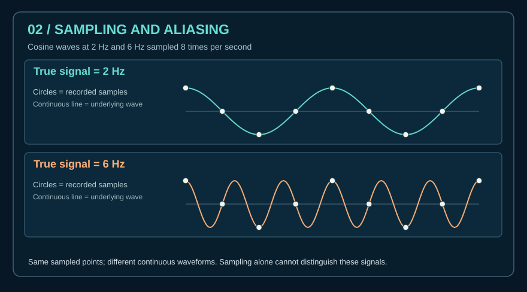

# Lesson 11 — Visual sampling and aliasing lab

**Goal:** Understand why multiple continuous frequencies can map to the same discrete samples.

**Read:** [Sampling and aliasing chapter](../docs/spectrum/04_sampling_and_aliasing.md).

**Activity:** Derive `cos(2π·2n/8) = cos(2π·6n/8)` for integer `n` using cosine periodicity. Write down the engineering assumptions needed to reconstruct an analog waveform from its samples.

**Check:** Explain how this differs from decoding a signal, identifying an emitter, or learning the radio allocation of a service. The activity uses only mathematical/synthetic data.
