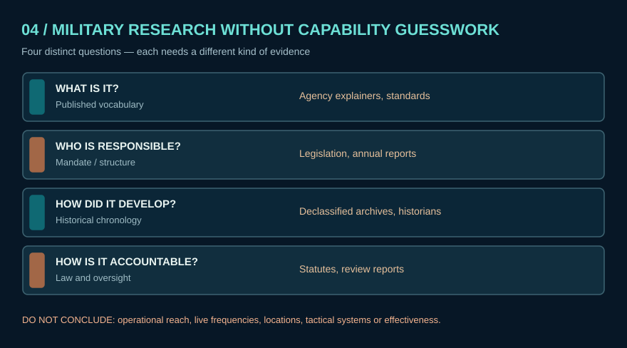

# Lesson 12 — Global historical archive research

**Goal:** Build one bounded, cited historical claim using only publicly released institutional archives.

**Read:** [Research desk](../docs/research/README.md), [comparative evidence lanes](../docs/military/07_comparative_evidence_lanes.md).

**Activity:** Choose one **historical** topic from the NSA, Australian ASD, or UK National Archives indexes. Find the source's document date, creator, collection series, and later interpretation. Write a 100–200 word finding distinguishing original archival fact from secondary commentary.

**Evidence standard:** Mark 'direct statement', 'government self-report', 'independent interpretation', 'inference', and 'unknown' in separate columns. No present-day tactical details.
