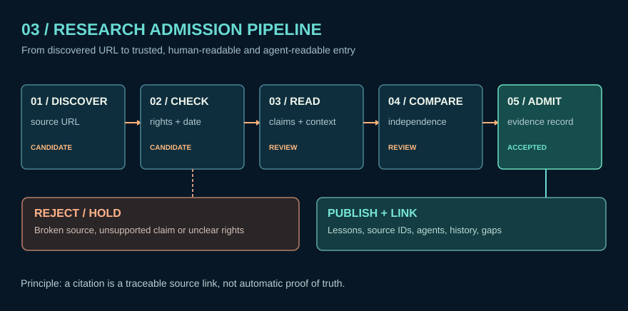

# Lesson 13 — Agent research with provenance

**Goal:** Teach humans and agents to track where a statement came from, when it applied, and what cannot be concluded.

**Read:** [Agent research contract](../docs/research/AGENT_RESEARCH_CONTRACT.md), [first batch findings](../docs/research/FIRST_BATCH_FINDINGS.md).

**Activity:** Use `python tools/atlas_query.py -j provenance`. Copy one returned `SRC` ID into a review note. Find a linked claim, state its evidence class and known limits. Suggest one counterevidence search query rather than promoting a guess.

**Check:** A successful output returns at least one resolvable original URL and makes no unsupported claim of independently verified military operational capability.
