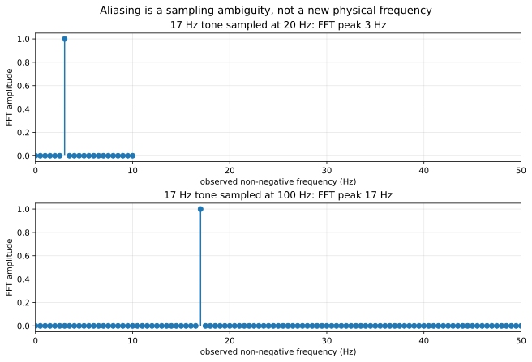
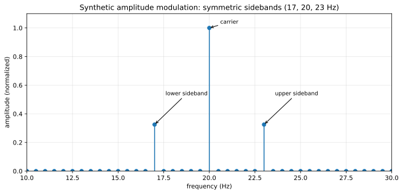

# Lesson 18 — Reproduce a signal-processing prediction

**Prerequisites:** lessons 11 and 15. **Data:** synthetic, generated locally.

## Learning target

Verify a known sampling prediction with transparent code, not a hidden simulation or a live radio recording.

The sampling frequency is `f_s`; Nyquist is `f_s / 2`. A sinusoid at `f=17 Hz` sampled at `20 Hz` is indistinguishable from a `3 Hz` tone in the discrete samples because `17 = 20 − 3` and cosine is symmetric. Sampling at `100 Hz` instead preserves a `17 Hz` peak within Nyquist. This is aliasing—not evidence that a signal changed its physical frequency.

A second experiment uses the original textbook AM model `x(t)=(1+m cos(2π f_m t)) cos(2π f_c t)` and shows the sidebands at `f_c ± f_m` for `f_c=20`, `f_m=3`, `m=0.65`.

## Reproduce

From repository root, install `numpy` and `matplotlib` in an isolated environment, then run `python experiments/signal_lab.py`. Compare machine-readable results in `data/experiments/signal_lab_v04.json` with the theoretical frequencies.

## Scientific controls and limitations

- No actual RF reception, interference, unknown source identification, or proprietary signal is involved.
- The data are noiseless, deterministic, precisely sampled and exactly frequency-bin aligned. Real recordings may have leakage, drift, noise, sample-clock error, and filtering artifacts.
- Demonstrating known Fourier facts **is not a new discovery**.

**Sources:** [MIT lecture notes](https://live.ocw.mit.edu/courses/res-6-007-signals-and-systems-spring-2011/pages/lecture-notes/) (catalog: source card) and [GNU Radio tutorials](https://wiki.gnuradio.org/index.php?title=Tutorials). These links provide context; the numerical results are generated locally.
