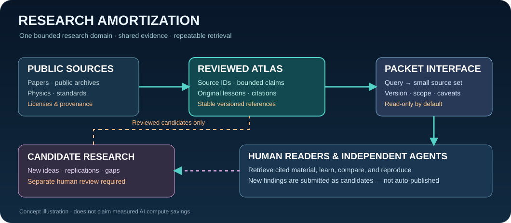

# Lesson 19 — Retrieve a reusable evidence packet

**Goal:** learn how compact source packets differ from knowledge claims and from external papers.

1. From repository root, run `python tools/packet_query.py sampling --limit 3`.
2. Inspect `sources[].id`, `url`, `review_scope`, `time_scope`, and `rights`.
3. Inspect `claims_attributed_to_sources[]`. Claims with `partial_evidence_selection=true` are not represented by every cited source in the packet; retrieve missing IDs before asserting complete support.
4. Run `python tools/benchmark_packets.py` and inspect its 10 fixed queries.
5. Compare the packet to the original source URL and explain why it cannot guarantee current accuracy.

**Assessment:** explain in your own words why small JSON payloads are not, by themselves, proof of end-to-end compute savings. State a falsifiable experiment that measures agent answer quality and compute cost against a proper RAG baseline.

**Rules:** packets are versioned, read-only, cite the source record, preserve limits, and separate candidate research from accepted knowledge. The packet search is lexical and retrieves curated metadata only; there is no live web harvesting.
