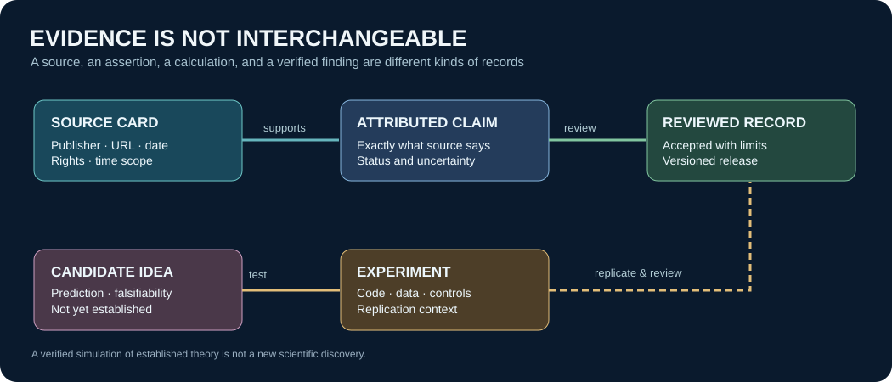

# Lesson 20 — Identify a real invariant, not a false discovery

**Goal:** distinguish a transferable methodological principle from a new scientific law.

Consider three domains: synthetic signal sampling, radio astronomy calibration, and speech corpus labeling. All require measurement descriptions that make interpretation possible, but their physical mechanisms are not identical.

## Exercise

Start with [SigMF metadata](https://sigmf.org/) and [the NRAO VLA observing guide](https://science.nrao.edu/facilities/vla/docs/manuals/obsguide). For each, list (a) what is measured, (b) units/sampling/timing, (c) calibration or assumptions, (d) licenses, (e) provenance and source, and (f) plausible error mechanisms.

Propose a candidate invariant: *Every reliable interpretation requires enough metadata to reconstruct the measurement context.* Treat this as a **methodological design hypothesis**, not an unprecedented law of physics. Invent a counterexample or scope limitation, specify a measurable operational outcome, and record it under a provisional note.

## Assessment

A passing answer clearly distinguishes established mathematics, single-source testimony, an experiment outcome, and a proposed research principle. Cite the actual source and do not promote hypotheses into reference truth automatically.
