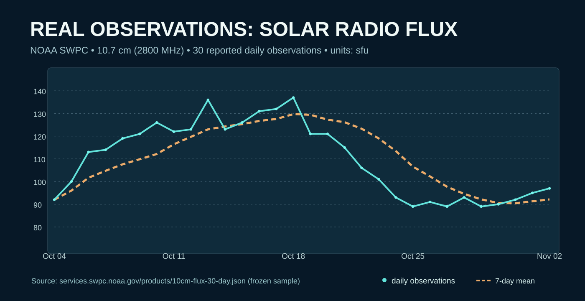

# Lesson 21 — Reading a real solar radio-flux record

**Level:** Applied science · **Duration:** 30–45 minutes · **Data:** actual NOAA SWPC JSON excerpt (30 days)

## Outcome

Explain what F10.7 represents, distinguish a physical observed record from a synthetic example, and reproduce a dated plot with its source and units attached.

The F10.7 index measures solar radio emissions around 10.7 cm (2800 MHz). The Atlas includes exactly 30 observational data points from 2026-10-04 to 2026-11-02, as visible from NOAA's 30-day endpoint during this research pass. The upstream data are credited by NOAA to Canada.

**Run the experiment:** `python experiments/noaa_f107_lab.py` from the repository root. Compare extrema and variability. Record that the window is *not* a solar cycle and cannot establish a causal link to any local communications event.

**References:** [SRC-114](https://www.spaceweather.gov/phenomena/f107-cm-radio-emissions), [SRC-116](https://services.swpc.noaa.gov/products/10cm-flux-30-day.json).

**Assessment:** Name the variable, units, sampling interval, limitations, and the source of the data; explain why a chart without this context is inadequate.
