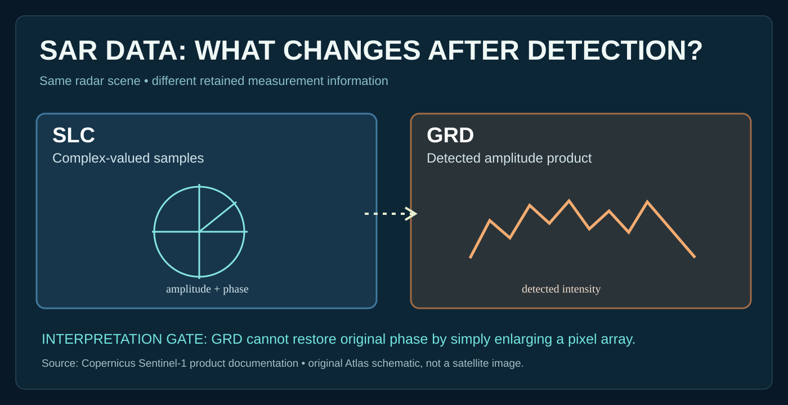

# Lesson 22 — When a radar product loses phase

**Goal:** Distinguish complex-valued Sentinel-1 Single Look Complex (SLC) radar measurements from Ground Range Detected (GRD) products.

A complex SAR sample has magnitude and phase. Detection transforms it into a magnitude-related representation. **The exact phase of the original complex signal is not recoverable merely by upscaling a detected amplitude image.** The example concerns product semantics, not defense collection techniques.

- Original archive: [Copernicus Sentinel-1 product documentation](https://documentation.dataspace.copernicus.eu/Data/SentinelMissions/Sentinel1.html).
- Atlas reference: `SRC-118`.

**Exercise:** Explain which measurement quantities must be retained for a repeatable interferometric analysis, then identify which part of the source documentation establishes this.

**Caution:** Product descriptions differ across modes and processing chains; always consult the source product specification.
