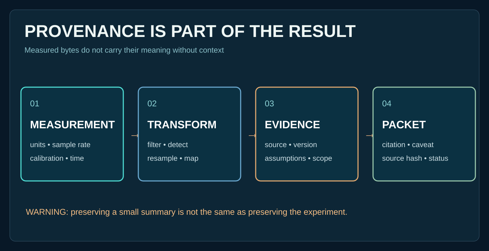

# Lesson 23 — Calibration assumptions are part of the evidence

**Goal:** Understand why two processing systems can produce different outputs from the same original signal despite each running correctly.

The radio interferometer measurement equation (RIME) offers a formal example: measurements depend on modeled gains, effects and instrument/sky assumptions. The cited papers discuss direction-dependent effects and generalizations of the Jones formalism.

**Read:** [Smirnov I](https://arxiv.org/abs/1101.1764), [Smirnov II](https://arxiv.org/abs/1101.1765), [Smirnov IV](https://arxiv.org/abs/1106.0579). Linked arXiv papers are external and **have not been fully audited** by this release.

**Exercise:** Draft a measurement record identifying raw samples, units, sampling rate, calibration procedure, processing stages, versions, and uncertainties.

**Critical distinction:** A calibration model is not a guarantee of ground truth.
