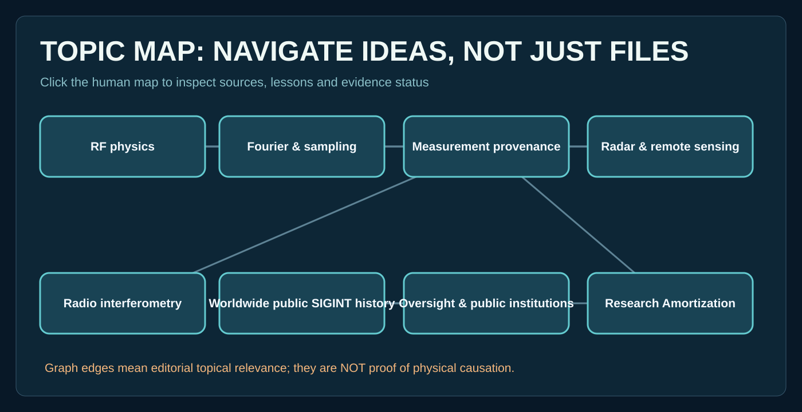

# Lesson 24 — Research Amortization with evidence intact

**Goal:** Build a reusable retrieval packet that includes enough detail to challenge, refresh, and verify a finding.

Run `python tools/packet_query.py solar flux --limit 5` and inspect the returned source URLs, time scope, rights, index hash, evidence statuses and packet SHA.

**Test:** Change the local source catalog in a working copy and show that the index hash changes. Rebuild the example packet and distinguish its contents from the original full scientific paper.

**Reproduction protocol:** [retrieval probes](../experiments/RETRIEVAL_EVALUATION_v05.md).

**Limitation:** Smaller JSON packets do not demonstrate lower model inference compute, and this lesson does not grant agents permission to update approved evidence.
