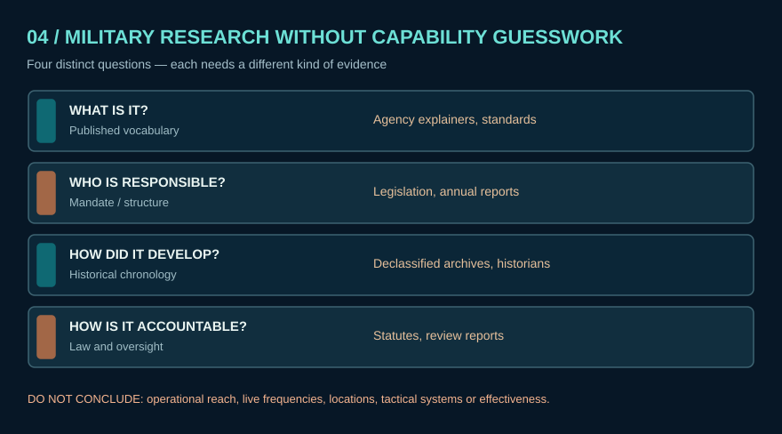

# Comparing countries through public evidence, without hidden-capability inference

A country comparison is stronger when it **separates four questions**:

1. **Definition:** What does the institution publicly call SIGINT or electromagnetic intelligence? (Example: [Australia ASD](https://www.asd.gov.au/about/what-we-do/signals-intelligence), [France DRM](https://www.defense.gouv.fr/drm/actualites/video-renseignement-electromagnetique-comment-ca-marche-quoi-ca-sert)).
2. **Mandate:** What does publicly available law or an agency's institutional page authorize or claim? (Example: [New Zealand GCSB](https://www.gcsb.govt.nz/about-us?url=about-us%2F)).
3. **History:** What do declassified records and archives show for a specified period? (Example: [Australian declassifications](https://www.asd.gov.au/about/history/declassified), [UK National Archives](https://www.nationalarchives.gov.uk/help-with-your-research/research-guides/intelligence-and-security-services/)).
4. **Oversight:** Which review institutions and legal limits are publicly described? (Example: [Dutch CTIVD](https://english.ctivd.nl/investigations), [UK ISC](https://www.gov.uk/government/groups/intelligence-and-security-committee)).

## Confidence pitfalls

- An agency's mission statement is **direct evidence of its public description**, not independent proof of operation.
- A historical case study cannot establish current coverage.
- Two secondary sites repeating one source are **not independent corroboration**.
- Regulatory spectrum allocation charts do not show active transmissions.
- Countries with sparse public records must remain 'low public-document coverage,' not 'low capability.'

This Atlas **does not collect** live military emission parameters, active unit locations, protected communications, target lists or operational methods. The comparative approach is historical, institutional, scientific and ethical.
