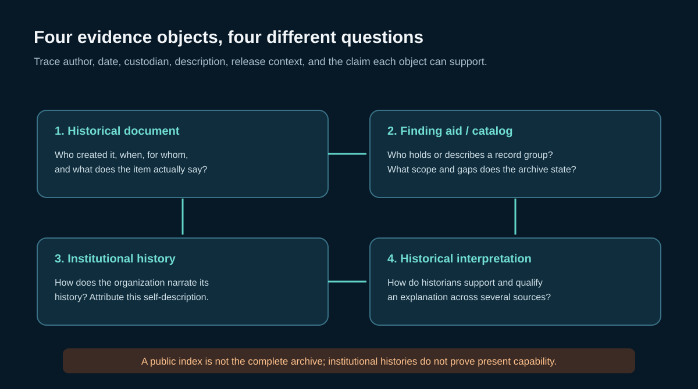

# Finding and citing public historical SIGINT records

This guide teaches a bounded route from archival discovery to an attributable historical claim. It covers public records and institutional histories only. It does not infer current collection capability, catalog operational targets, or describe secret methods.

## Start with the evidence object

Keep these four objects separate: the historical document; the later finding aid or catalog description; an institution's retrospective history; and a historian's interpretation. For each, capture its author or issuing body, date, record identifier, holding institution, release or access condition, and the exact statement used. A catalog entry supports a statement about the described record or archive; cite the underlying document for an event claim.

## Public pathways in this release

| Collection or account | Useful starting point | What it can establish | Boundary |
| --- | --- | --- | --- |
| U.S. NARA Record Group 457 | [NARA record-group guide](https://www.archives.gov/research/guide-fed-records/groups/457.html), [NARA NSA research guide](https://www.archives.gov/research/intelligence/nsa) | Archival scope and the presence of records from NSA/CSS and predecessor organizations | NARA notes that many items were created by predecessor bodies; record-group membership is not proof of authorship or completeness. |
| NSA historical releases | [William F. Friedman collection](https://www.nsa.gov/Helpful-Links/NSA-FOIA/Declassification-Transparency-Initiatives/Historical-Releases/Friedman-Documents/), [NSA 60th timeline](https://www.nsa.gov/Helpful-Links/NSA-FOIA/Declassification-Transparency-Initiatives/Historical-Releases/NSA-60th-Timeline/) | Finding selected public scans and agency-curated historical context | Use each item's identifier and date. Selection and release do not make a timeline a complete history. |
| United Kingdom | [The National Archives intelligence research guide](https://www.nationalarchives.gov.uk/help-with-your-research/research-guides/intelligence-and-security-services/) | Starting points such as HW records for GCHQ-related records and neighboring government series | TNA states many intelligence records are not transferred or available online; a finding aid does not prove document content. |
| Canada | [CSE institutional history](https://www.cse-cst.gc.ca/en/culture-and-community/history/our-story) | CSE's published chronology and its account of predecessor organizations | Cite as CSE's institutional account; corroborate event claims where possible. |
| Australia | [ASD historical account](https://www.asd.gov.au/about/history/asd-stories/2022-03-16-bureau-melbourne-directorate-canberra) | ASD's account of postwar organizational names and dates | Cite as ASD's institutional account; do not infer present capabilities. |

The catalog already includes linked records for NARA RG 457 and the UK National Archives guide, as well as newly added NSA, CSE, and ASD history pages. Records remain externally hosted; nothing is copied into this release.

## A repeatable search and citation routine

1. State a time-bounded historical question and what evidence would answer it.
2. Search the finding aid or catalog by agency, record group or series, date range, and subject. Record the query and the exact item identifier.
3. Open the specific document when publicly available. Capture title, authoring office, date, recipient, page or folio, release marker, and URL. If a document is unavailable, label the claim as finding-aid-only.
4. Separate what the record says from what the institution says about itself and from your inference. Quote or paraphrase only the relevant passage and preserve the source's qualification.
5. Compare independent records where a contested event or chronology matters. Shared institutional authorship is not independent corroboration.
6. Record gaps, retention rules, redactions, and selection bias. “Not found” means not located in the searched scope, not “did not happen.”
7. Recheck access, dates, and links before reuse. Preserve a dated citation manifest and hashes for any locally lawfully held documents.

## Source criticism questions

- Was the item created contemporaneously, or written later as a retrospective account?
- Is the author the document creator, archive describer, agency historian, outside historian, or later analyst?
- Does the record support the event, only the fact that an office recorded a statement, or only the archive's catalog description?
- Are two apparent confirmations genuinely independent, or do they repeat the same institutional account?
- Is the record redacted, excerpted, translated, or publicly available only as a scan with OCR limitations?
- What record groups, date ranges, and repositories were not searched?

## Evidence status

Use `official-finding-aid-description` for archival scope; `institutional-self-description` for an agency history; `document-observed` only after checking the item itself; `secondary-analysis` for a historian's sourced interpretation; and `inference` for your own synthesis. The status belongs beside the exact claim, not only in a bibliography.

Related sources: [CSE history](../../data/sources.csv), [ASD history](../../data/sources.csv), [NSA archival descriptions](../../data/sources.csv), [v0.6 claim ledger](../../data/claims.jsonl).
