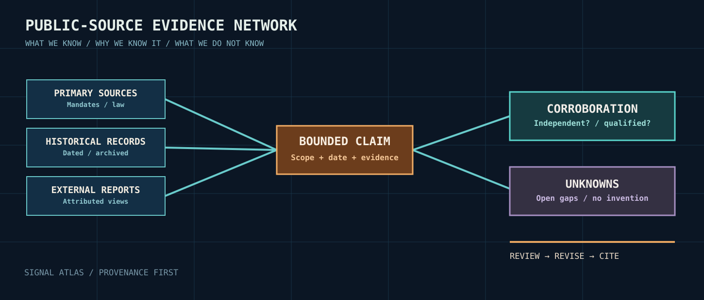

# Global military signals intelligence — research division

The aim is to understand **worldwide military use and development of SIGINT through legitimate public records**, while separating published doctrine, institutional mandates, historical accounts, third-party analyses, and unknowns. This is an education/reference project, not an operational emitter catalog.

1. [Terms and categories](01_definitions.md)
2. [Role in military decision-making](02_application_framework.md)
3. [SIGINT vs electromagnetic warfare](03_sigint_vs_emw.md)
4. [Comparative worldwide survey](04_global_survey.md)
5. [Building broader pictures from incomplete documents](05_source_fusion.md)
6. [Historical study track](06_history.md)

Country/organization entries: [regions](../regions/README.md). Data: `../../data/entities.jsonl`, `../../data/claims.jsonl` and `../../data/coverage_matrix.csv`.

**New:** [Comparative evidence lanes](07_comparative_evidence_lanes.md) — historical, legal and documentary research, not a current operational inventory.

## Edition 0.6 public records guide

[Finding and citing public historical SIGINT records](PUBLIC_RECORDS_WORKFLOW_v06.md) distinguishes an item-level record from a finding aid, an institutional history, and a later interpretation. It routes readers to public U.S. NARA/NSA collections, the UK National Archives guide, and CSE/ASD institutional histories. These sources are selective and dated; they do not establish current capability or archive completeness.
