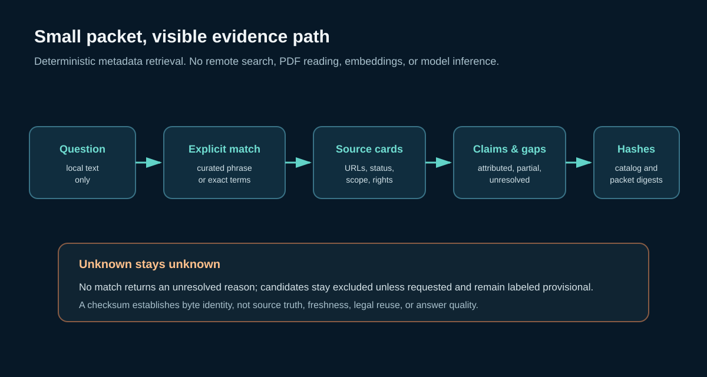

# Signal Atlas research packet format 0.6

## Purpose

Version 0.6 produces a small, deterministic packet from local curated metadata. Each packet carries hashes for the exact source catalog, claim ledger, and alias table used, and retains URLs, review status, time scope, rights notes, and source-to-claim links. The packet is a navigation and provenance aid; a reader should open and assess the cited source.

## Retrieval behavior

`python tools/packet_query_v06.py "clock stability" --limit 5` matches phrases in the versioned curator alias table and direct catalog metadata. Alias matches map to explicit source IDs and are returned with the matched phrase and mapping basis. Exact metadata retrieval requires meaningful query tokens to appear in source metadata. The method uses no network, full text, PDF bytes, vector index, embedding, or model.

Unmatched queries return an explicit unresolved entry. Candidate research notes are excluded unless `--include-candidates` is supplied; included candidates remain labeled `candidate-not-validated` with their limitations. A claim may be included when only some of its supporting source IDs are in the packet; `partial_evidence_selection` marks that incomplete selection.

## Packet fields

| Field | Meaning |
| --- | --- |
| `schema`, `atlas_version`, `created_at` | Packet and catalog release identity |
| `retrieval_method` | Deterministic local metadata and curated alias method |
| `input_sha256` | SHA-256 of the exact source JSONL, claims JSONL, and alias JSON used |
| `sources` | Selected source cards, match reason, provenance, rights, and original URL |
| `claims_attributed_to_sources` | Claim status, all cited source IDs, matched IDs, and partial-selection flag |
| `candidate_notes` | Empty by default; provisional notes when explicitly requested |
| `unresolved` | Query portions or the whole request not covered by a local card |
| `packet_sha256` | Digest of canonical UTF-8 JSON before this digest field is added |

## Integrity and evidence limits

To verify a packet, remove `packet_sha256`, serialize the remaining JSON with sorted keys, compact separators, and UTF-8, then SHA-256 the bytes. Separately hash each input file and compare it to `input_sha256`. A matching digest establishes byte identity, not factual truth, independent corroboration, source availability, license, or freshness. A packet may contain paraphrased catalog metadata rather than the underlying article or record.

The alias file is an editorial mapping. Its phrases and source IDs are inspectable in `data/query_aliases_v06.json`; an alias is a retrieval hint, not proof that every use of a phrase has the same meaning. The seven legacy diagnostic repairs are explicitly annotated as retrospective, and the resulting score is not a held-out result. This release makes no claim about answer quality, model behavior, latency savings, or reduced inference compute.

Run `python tools/evaluate_packets_v06.py` to reproduce the historical query-set compatibility diagnostic. Run `python -m unittest discover -s tests -v` and `python tools/validate_v06.py` for the release checks.
