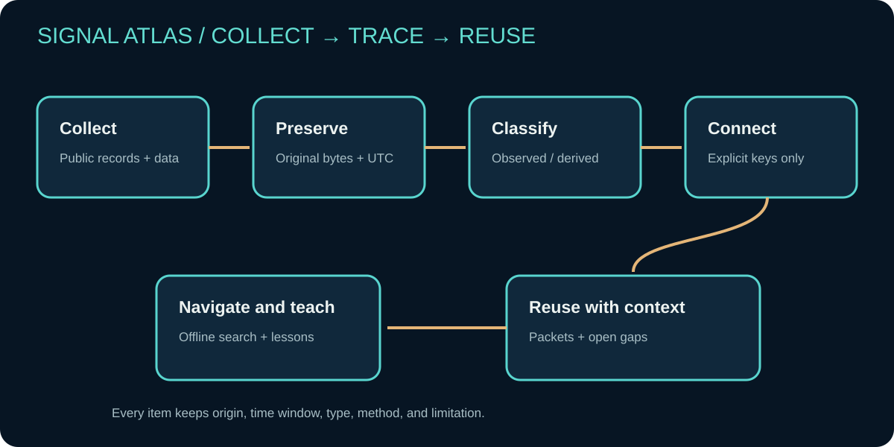

# Public historical SIGINT records added in v1.0

This batch adds public records and accounts from NSA and GCHQ, plus ASD's institutional history. It keeps record types distinct so readers can follow a useful research route.

| ID | Record kind | Use | Boundary |
| --- | --- | --- | --- |
| SRC-061 | NSA history-publication catalog | Find public studies across periods and topics. | Catalog is a route, not the complete record. |
| SRC-148 | NSA recollection collection | Locate audio and transcript testimony. | Preserve speaker, date, and context. |
| SRC-149 | GCHQ historian interpretation | Study the Pearl Harbor warning question. | Attribute the interpretation; not independent adjudication. |
| SRC-150 | ASD institutional history | Follow the agency's published chronology. | Self-description, not current capability. |
| SRC-151 | GCHQ postwar account | Find letters and accounts about Bletchley personnel. | Keep writer, date, and editorial context attached. |

## Workflow

1. Classify the evidence: catalog, released record, recollection, institutional history, or historian's interpretation.
2. Open the original material and note creator, date, holder, release context, and scope.
3. Keep testimony and inference separate; cite a specific item for an event claim.
4. Use [offline search](../../site/unified_search.html) and [coverage](../../site/coverage.html) to explore related records and collection gaps.

Claims C-077 through C-081 retain publisher attribution. Public access does not establish historical completeness.

## Original records

- [NSA Historical Publications](https://www.nsa.gov/serve-from-netstorage/History/Cryptologic-History/Historical-Publications/index.html) — SRC-061.
- [NSA Voices from the Past](https://www.nsa.gov/History/Cryptologic-History/Voices-from-the-Past/) — SRC-148.
- [GCHQ historian on Pearl Harbor](https://www.gchq.gov.uk/information/did-signals-intelligence-predict-attack-pearl-harbor) — SRC-149.
- [ASD history](https://www.asd.gov.au/about/history) — SRC-150.
- [GCHQ postwar correspondence article](https://www.gchq.gov.uk/news/gchq-shares-what-happened-next-for-the-codebreakers) — SRC-151.

