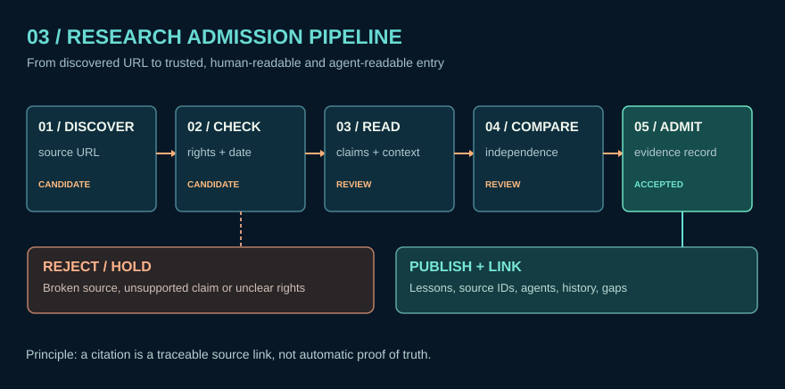

# Research Desk — evidence workspace (v0.2)

This area contains **new research that is being reviewed**. It is distinct from the stable reference library.

## Research progression

1. **Discover:** find indexed primary, official or scholarly material; create a `SRC` entry with date, URL, country, language, reuse status.
2. **Review:** inspect the primary publication, original document date and surrounding context. Distinguish editorial summary from copied original.
3. **Compare:** note genuinely independent sources, contradictions, and alternative explanations.
4. **Propose:** record a `C` claim with precise wording, time scope, primary support and limits; new unverified hypotheses remain in the gap queue.
5. **Admit:** human/editorial decision; move a reviewed claim into the trusted subset only when its evidence class and scope are documented.
6. **Teach:** write or revise an illustrated lesson, verify navigation and accessibility.
7. **Version:** commit changed cards, learning materials, and an audit trail; rerun integrity tests.

## Routes

- [Research notes](../../data/research_notes.jsonl) — eight first-pass essays; their status is **editorial-first-pass**, not peer-reviewed.
- [Current discovery batch](../../data/discovery_batches/2026-11-02-B.md) — what was checked and what was not.
- [Claims](../../data/claims.jsonl) — source-attributed statements.
- [Research questions](../../data/research_questions.jsonl) — unanswered, bounded questions.
- [Agent retrieval protocol](../../AGENTS.md) — evidence-aware AI handling.
- [Editorial release checklist](REVIEW_CHECKLIST.md) — release gates.

**Separation:** candidate research is not synonymous with verified fact. The source index represents URLs and editorial metadata; it does not contain mirrored full source documents.

- [Coverage audit](COVERAGE_AUDIT.md) — domain/region source counts and limitations.
- [Integration roadmap](INTEGRATION_ROADMAP.md) — read-only agents first, then candidate research with human approval.

## v0.3 additions

[Science coverage audit](SCIENCE_COVERAGE_AUDIT.md) · [Repeatable research rotation](RESEARCH_ROTATION.md) · [Prior Deep Research synthesis](DEEP_RESEARCH_SYNTHESIS_2026-11-02.md)

## v0.4 packet and experiment lane

[Research Amortization](RESEARCH_AMORTIZATION.md) outlines read-only citation-preserving packet retrieval; [the actual experiment record](../../experiments/README.md) describes the numerical and metadata checks. Unverified discoveries remain Research Desk candidates.

## Edition 0.5 research pass

- [Source review and limitations](SOURCE_REVIEW_v05.md)
- [Research Amortization measured versus proposed](RESEARCH_AMORTIZATION_v05.md)
- [Release audit](RELEASE_AUDIT_v05.md)
- [Real observation lab](../../experiments/noaa_f107_lab.py)
- [Human topic navigation](../../site/topic-map.html)

## Edition 0.6 packet and evidence updates

- [v0.6 packet schema and integrity limits](PACKET_SCHEMA_v06.md)
- [Packet retrieval compatibility diagnostic](../../data/experiments/packet_probe_v06.json) — exact v0.5 query set; known-target alias repairs; not held out.
- [Frequency-stability measurement chapter](../science/07_frequency_stability_and_uncertainty.md) and [reproducible synthetic lab](../../experiments/frequency_stability_lab_README.md)
- [Public-records workflow](../military/PUBLIC_RECORDS_WORKFLOW_v06.md)
- [v0.6 release audit](RELEASE_AUDIT_v06.md) and [release summary](RELEASE_SUMMARY_v06.md)

## Version 1.0

- [Unified search and coverage](UNIFIED_SEARCH_AND_COVERAGE_v10.md)
- [Collection guide](DATA_COLLECTION_GUIDE_v10.md) · [public history](PUBLIC_HISTORICAL_RECORDS_v10.md)
- [Summary](RELEASE_SUMMARY_v10.md) · [audit](RELEASE_AUDIT_v10.md) · [handoff](../../THREAD-RESUME-HANDOFF.md)
