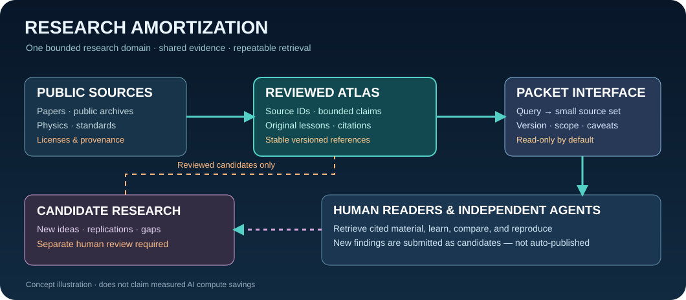

# Research Amortization — Signal Atlas implementation (v0.4)

This is a **short implementation note**, not a white paper.

## Defined terms

- **Research Amortization (RA)** — amortizing upfront discovery, validation, and synthesis across many downstream readers and model calls.
- **Research Amortization Layer (RAL)** — proposed read-only retrieval boundary that serves bounded, evidence-backed packets.
- **Research packet** — a query-scoped, versioned record with linked source IDs, source URLs, rights, time scope, claim statuses, and caveats.
- **Research delta** — source/claim changes since a previous indexed release, eligible for targeted re-review.

## Already implemented

`python tools/packet_query.py "sampling" --limit 5` creates a deterministic metadata-only JSON packet. The tool never opens a website, fetches a PDF, or writes to the reference collection. Source IDs and all claim source IDs remain visible. Partial evidence selection is flagged. Optional `--include-candidates` keeps candidate notes separately marked.

This supports independent integration by other agents through JSON *without connecting to them, granting permissions, or allowing auto-promotion*. A future connector should compare release digest, validate packet schema, check rights and expiry, and re-open the source when a fact requires freshness.

## What the experiment actually measures

The benchmark at `data/experiments/packet_benchmark_v04.json` checks source-ID presence in the first five results of ten intentionally selected **in-corpus** metadata questions. It compares packet JSON bytes to all source-card JSONL bytes, which is a weak baseline. It **does not measure agent compute, accuracy, latency, vector search, page harvesting, network costs, or maintenance overhead**.

## Proper next scientific evaluation

Pre-register a held-out set of questions with human-vetted source-ground truth. Compare (A) source-first web/RAG research, (B) directly indexed local atlas, and (C) cached packets under matched model/task settings. Record full build+update cost, tokens, time, factual accuracy, citation validity, stale answers, and failure modes. Include cache misses and reversals, not just successful reuse.

## Governance

Research Desk proposals are not accepted claims. Only reviewed, source-grounded material enters a numbered stable Atlas release; no current or sensitive tactical emitter catalogs or private interceptions are permitted. Publicly viewable material is not automatically reusable under copyright.
