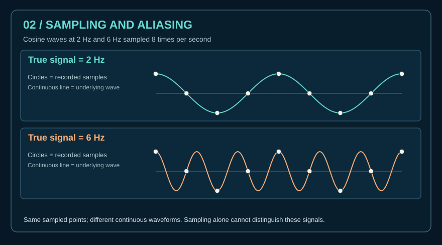

# Sampling, frequency and aliasing

A continuous signal can contain frequencies too high for a chosen sampling rate to distinguish. For example, when sampling real cosines at **8 samples per second**, a 2 Hz cosine and a 6 Hz cosine produce the same samples at whole sample indices (the idealized diagram illustrates this).

If the highest frequency to preserve is strictly below half the sampling frequency and the signal meets other reconstruction assumptions (notably band limitation), ideal sampling supports perfect reconstruction. The **Nyquist frequency** is half the sampling frequency; practical anti-alias filtering and sampling margin matter.

### Safe synthetic lesson

1. Draw a 2 Hz cosine over 1 second.
2. Draw a 6 Hz cosine over the same interval.
3. At times `t = n/8` seconds, evaluate both; the sampled values match within numerical precision.
4. Explain why a sampled spectrum cannot identify the true analog frequency without assumptions.

**Do not confuse:** sample rate (samples/second), RF carrier frequency (Hz), bandwidth (Hz), frequency allocation (rules), or live transmissions.

References: MIT [signals and systems video course](https://live.ocw.mit.edu/courses/res-6-007-signals-and-systems-spring-2011/video_galleries/video-lectures/) and [lecture notes](https://ocw.mit.edu/courses/6-003-signals-and-systems-fall-2011/pages/lecture-notes/).
