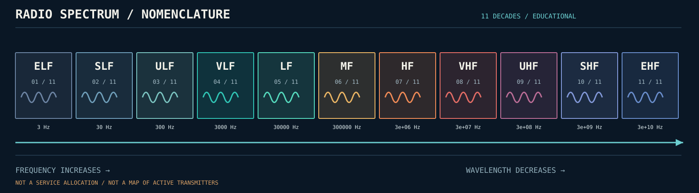

# Spectrum atlas

A spectrum band is a broad **frequency range**, not a station identifier, license, channel plan, or proof of what is actually transmitting. Radio allocations vary by country and change over time. Our structured generic bands are stored in `data/frequency_bands.json`.

1. [Waves, units and wavelength](01_waves_and_units.md)
2. [Modulation and signal families](02_signal_families.md)
3. [Regulation vs physical reality](03_allocation_vs_observation.md)

Primary references: SRC-001 (NASA), SRC-002 (NASA), SRC-003 (NTIA), SRC-004 (ITU).

**Next:** [Sampling and aliasing (illustrated)](04_sampling_and_aliasing.md).
