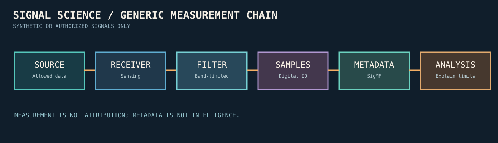

# Technology and laboratory study

The practical work is designed for **synthetic signals, public scientific datasets, and authorized systems**.

| Layer | Technical concepts | Educational resource |
|---|---|---|
| Electromagnetic | Waves, attenuation, propagation, wavelength | NASA SRC-001 / SRC-002 |
| Antennas | Polarization, directionality, resonance | NASA SRC-008; consult authoritative RF texts |
| Receiver | Tuners, filtering, gain, analog-to-digital conversion | GNU Radio SRC-005 |
| Signal processing | Sampling, filtering, FFT, modulation | GNU Radio SRC-005 |
| Metadata | Sample rate, center frequency, time, formats, provenance | SigMF SRC-006 |
| Data archival | Checksums, rights, reproducibility, datasets | SigMF SRC-006 |
| Space science | Legitimate public satellite ground-station learning | SatNOGS SRC-007 / SRC-034 |

**Lab 1:** Plot a synthesized waveform at 50 and 100 cycles per second.  
**Lab 2:** Compare two noise levels on synthetic data and describe uncertainty.  
**Lab 3:** Make a SigMF-style metadata card for a *synthetic* dataset; do not collect third-party traffic.  
**Lab 4:** Read SatNOGS documentation and identify which components provide scheduling, observations, antennas and shared metadata.

This guide is a study path, not a laboratory safety certification or authorization to transmit/receive regulated communications.

**New:** [Signal metadata and interoperable formats](02_signal_metadata_and_formats.md).

## v0.5 measurement metadata and radar

- [SigMF metadata specification](https://sigmf.org/)
- [Copernicus Sentinel-1 scientific product documentation](https://documentation.dataspace.copernicus.eu/Data/SentinelMissions/Sentinel1.html)
- [Original phase-retention diagram](../../assets/sar_measurement_products_v05.svg)
